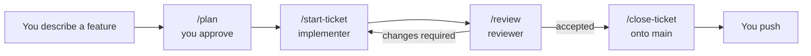

# dev-harness

[](https://github.com/d85275/claude-harness/actions/workflows/test.yml)

**Let Claude Code agents build your project ticket by ticket, while you stay in charge.**

dev-harness is a Claude Code plugin for solo developers and small teams. It gives agents a workflow and guardrails:

- **One ticket, one agent, one commit.** Each task has a written scope and done criteria. An implementer agent does it in its own git worktree (a separate checkout), so parallel work does not collide.
- **Independent review.** A separate reviewer reruns the tests and reads the diff instead of trusting the implementer's report. Risky changes get a stronger model.
- **Risky actions ask first.** Pushes, pull requests and deploys ask for your approval. Reading known credential files is blocked.
- **A ticket board.** Tickets are Markdown files in your repo. The board is one HTML page that works offline.


## Install

You need Claude Code, git and Python 3.9 or newer. Tested on macOS and Linux (Ubuntu) in CI; desktop notifications are macOS only.

In Claude Code:

```text
/plugin marketplace add d85275/claude-harness
/plugin install dev-harness@dev-harness
```

Then restart Claude Code.

The guards work in every project where the plugin is enabled. The ticket commands and the board only act in projects you set up with `/ticket-init`; a project with its own ticket system is left alone. Settings, the board commands and the optional git hooks are in [docs/configuration.md](docs/configuration.md).

## How it works



Your main Claude Code session is the **coordinator**: it plans, starts the agents and judges the reviews. The other roles are agents that the plugin starts:

| Role | Model | What it does |
|---|---|---|
| Coordinator (your main session) | Your choice; Opus recommended | Plans tickets, starts agents, judges reviews |
| Implementer | Sonnet | Does one ticket in its own worktree and makes one commit |
| Advanced implementer | Opus | The same, for high-risk tickets |
| Reviewer | Sonnet | Reruns the tests and reads the diff; changes nothing |
| High-risk reviewer | Opus (or Fable, if you opt in) | A stricter review for high-risk tickets |
| Silent-failure hunter | Sonnet | Extra review for error handling: swallowed errors, silent fallbacks |

A ticket is **high-risk** when it touches things like login, payments, deleting data, security or releases; you list your own categories. More about the agents: [docs/agents.md](docs/agents.md).

## Quickstart

1. In your project, run `/ticket-init` and answer its questions (ticket ID prefix, main branch, and so on). Add `docs/tickets/board.html` to `.gitignore`.
2. Fill in the `## Harness` section it added to `CLAUDE.md`: how to run your tests, your commit format, and what counts as high-risk.
3. Run `/plan Make search ignore accents`. Approve the plan, and it writes ticket `WEB-1`. Commit the new files.
4. Run `/start-ticket WEB-1`. The implementer works in the background and reports when it is done.
5. Run `/review WEB-1`. If changes are needed, the coordinator sends them back and starts the next round itself. After three rounds it asks you.
6. Run `/close-ticket WEB-1`. It puts the commit on `main` and marks the ticket Done.
7. Open `docs/tickets/board.html` in a browser. Push `main` when you are ready.

If another plugin has a command with the same name, use the full form, such as `/dev-harness:plan`.

## What the guards do

The guards check each Bash, Read, Edit and Write call. They ask you, block the call, or let it through.

| An agent tries to | Result |
|---|---|
| Push, open or merge a pull request, create a release | Asks you (set `pushPolicy` to `"deny"` to block) |
| Deploy, or run destructive cloud commands | Asks you |
| Read keys, `.env` files or other credentials | Blocked |
| Change lint, test or `.claude` settings, or add a test skip | Asks you |
| Commit generated files such as `node_modules/` or `build/` | Asks you |
| Reset all simulators or emulators while a build runs | Blocked |

The guards match command text, so indirect forms (scripts, variables) can get through. They are guardrails, not a sandbox. Every rule and its known gaps: [docs/guards.md](docs/guards.md).

## The ticket board

`dev-harness-board` turns your tickets into one HTML page with columns, search, filters, and light and dark themes. A red "mismatch" badge marks a ticket whose tracker row and ticket file disagree.


Try the [example board](docs/examples/board.html), built from a [made-up sample project](examples/sample-project). Commands: [docs/configuration.md](docs/configuration.md#the-ticket-board-commands).

## Limits

- Pushes ask by default. Letting agents push feature branches without asking is planned after 1.0.
- `/ticket-init` sets up new projects only. Moving a project that already has its own tickets is planned after 1.0.
- The guards miss indirect forms; see [docs/guards.md](docs/guards.md).

[CHANGELOG](CHANGELOG.md) · [Contributing](CONTRIBUTING.md)

## Credits

Ideas borrowed from [Chachamaru127/claude-code-harness](https://github.com/Chachamaru127/claude-code-harness) and [affaan-m/ECC](https://github.com/affaan-m/ECC).

## License

MIT
