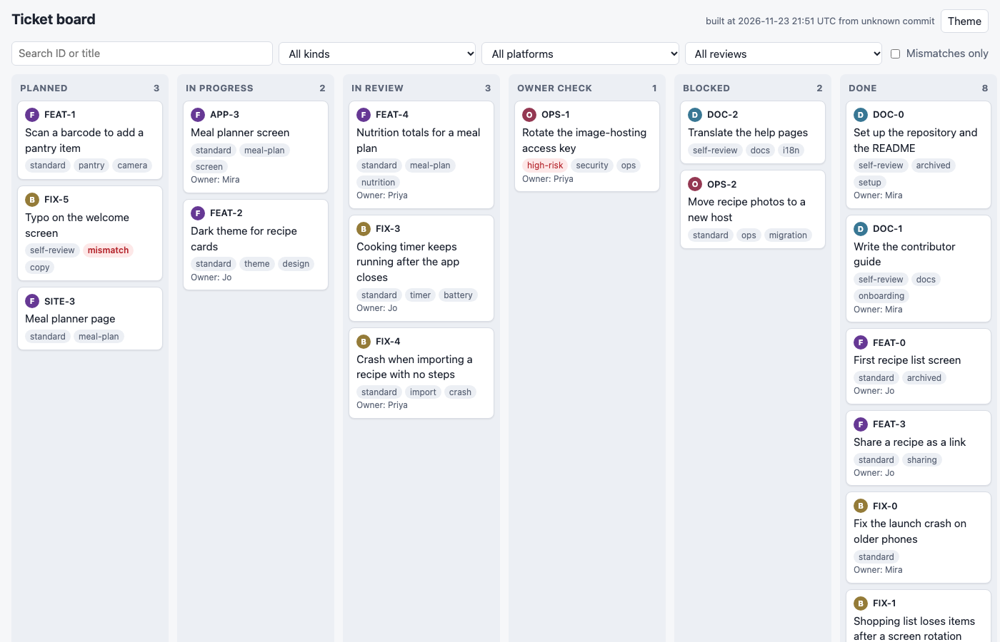
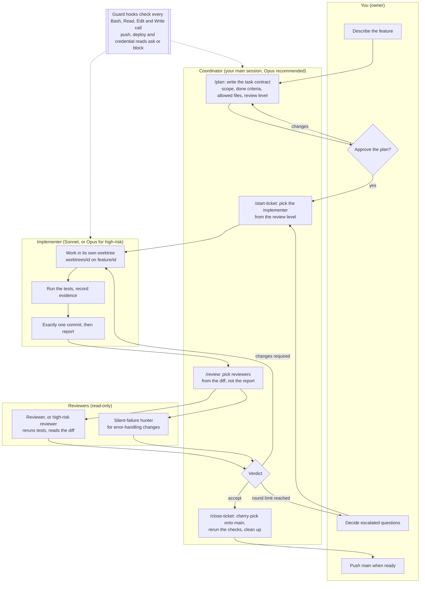
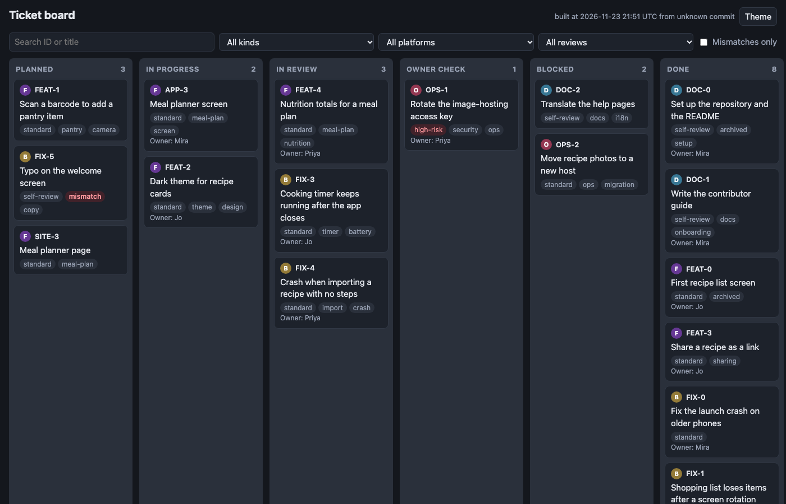
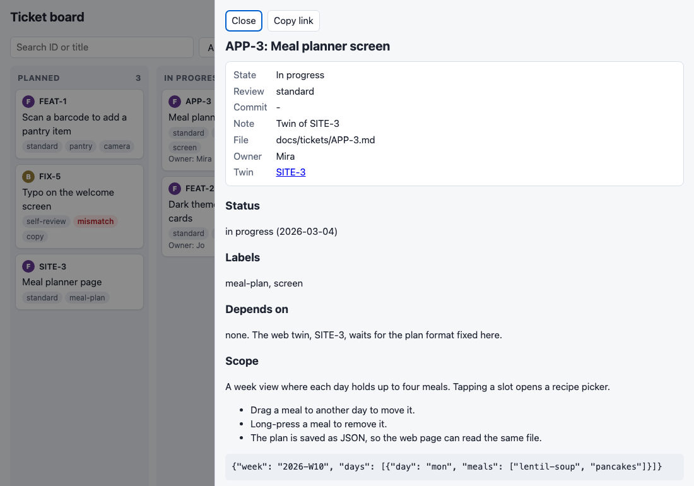

# dev-harness

**Let Claude Code agents build your project ticket by ticket, while you stay in charge.**

AI coding agents are fast. But they say "done" without proof, they review their own work, they wander outside the task, and sometimes they push code or delete things you never meant them to touch.

dev-harness is a Claude Code plugin that gives agents a workflow and guardrails. It is for solo developers and small teams who run multi-week projects with Claude Code. It grew out of porting a production Android app to iOS, one ticket at a time.

- **One ticket, one agent, one commit.** Each task has a written scope, done criteria and a list of files it may touch. An implementer agent works in its own git worktree, so parallel work does not collide.
- **Independent review that checks evidence.** A separate reviewer reruns the tests and reads the diff. It does not trust the implementer's report. Risky changes get a stronger model and a stricter reviewer.
- **Risky actions ask first.** Pushes, pull requests and deploys ask for your approval. Reads of known credential files are blocked. An edit that adds a test skip or a lint suppression asks first.
- **A ticket board for plain Markdown tickets.** Tickets stay as files in your repo. The board is one HTML page that works offline.

These guards are best-effort. They match command text, so indirect forms (scripts, variables) can get through. They are guardrails, not a sandbox: Claude Code permission deny rules are the hard boundary. See [Limits](#limits).



## Getting started

### Prerequisites

Claude Code, git, Python 3.9 or newer and `/bin/sh`. macOS is the main target. Linux is covered by the test workflow in `.github/workflows/test.yml` (Ubuntu and macOS, Python 3.9 and 3.13), which has not run yet, so treat Linux as untested until it has; desktop notifications are macOS only. The plugin has no other dependencies.

### Install

Inside Claude Code:

```text
/plugin marketplace add d85275/claude-harness
/plugin install dev-harness@dev-harness
```

Or from a terminal (the `/plugin` form is not a shell command):

```sh
claude plugin marketplace add d85275/claude-harness
claude plugin install dev-harness@dev-harness
```

Restart running Claude Code sessions to pick up the agents, commands and hooks.

### What this installs and changes

- **Guards.** The guard hooks run on every Bash, Read, Edit and Write call in every project where the plugin is enabled, not only after `/ticket-init`.
- **`/ticket-init`.** It writes only after showing you the file list. It creates the ticket template, the tracker, `docs/STATUS.md` and the board. It adds a `## Harness` section to `CLAUDE.md` (appended; an existing Harness section is never edited) and adds missing `tickets` keys to `.claude/harness.json`. It commits nothing.
- **Git hooks (optional).** `dev-harness-board install-hooks` makes git rebuild the board after commits and checkouts, in your clone only. To remove them, run `dev-harness-board uninstall-hooks` before you uninstall the plugin, or later `git config --unset core.hooksPath`. If the plugin is gone and the hooks are still set, they only print one line that the board was not rebuilt, and git carries on. `dev-harness-board` is on the PATH of Claude Code's Bash tool while the plugin is enabled; in an ordinary terminal, run it by its path (`python3 <plugin folder>/bin/dev-harness-board`). Details, including Git LFS, are in [docs/configuration.md](docs/configuration.md#board-git-hooks).

## Words used here

- **Owner**: you. **Coordinator**: your main Claude Code session, which plans, starts agents and judges reviews.
- **Worktree**: a second checkout of your repo, in its own folder and branch, where one agent works.
- **Ticket**: a Markdown file for one task. **Tracker**: the table with one row per ticket; its State column is the source of truth.
- **Review level**: `standard` (reviewer), `high-risk` (stronger implementer and reviewer) or `self-review` (trivial docs or test changes the coordinator checks itself).
- **State**: Planned, In progress, In review, Fixing (the implementer is amending after review), Owner check (done, waiting for you to confirm), Done, Blocked, Deferred.
- **Guard**: a hook that checks each tool call and asks, blocks or allows it. **Evidence**: the real commands and results an implementer records, which the reviewer reruns.
- **Twin**: the same ticket on a mirrored platform, such as iOS and Android.
- **Handoff docs**: your notes on the current state and the next step (for example `docs/STATUS.md`). **Drift**: when those docs say one thing and the repository another.

## Five-minute quickstart

Commands are written `/plan` here. If another command has the same name, use the full form, `/dev-harness:plan`.

1. **Set up.** In your project, run `/ticket-init`. It asks: the ticket ID prefix (such as `WEB`), the main branch, whether to archive closed tickets, twin platforms (leave off unless the same feature ships as separate tickets for each platform), and whether to install the git hooks that rebuild the board (you can say no). Then say yes to the file list.
2. **Fill in the `## Harness` section** of `CLAUDE.md`, replacing the `<...>` placeholders. Agents read it. For example (in the commit format line, `<type>` and the others are literal; keep them as written):

   ```markdown
   - **Verify**: focused `npm test -- <file>`; full `npm test`; static `npm run lint`.
   - **Commit format**: `<type>: <id-lowercase> <summary>`.
   - **High-risk categories**: login and accounts, payments, deleting data, release.
   - **Build caches**: none to clean up.
   ```

3. **Ignore the generated board.** `docs/tickets/board.html` is generated. Add it to `.gitignore`; otherwise the guard asks before you commit it. (`/ticket-init` reminds you.)
4. **Plan a ticket.** Run `/plan Make search ignore accents`. The coordinator reads your code, drafts a contract (scope, done criteria, allowed files, review level) and proposes a ticket ID such as `WEB-1`. When you approve, it writes `docs/tickets/WEB-1.md` and a Planned row in `docs/tickets/tracker.md`. Commit those files, together with the files from steps 1 to 3 (`CLAUDE.md`, `.claude/harness.json`, the tracker, the template, `docs/STATUS.md` and `.gitignore`).
5. **Implement.** Run `/start-ticket WEB-1`. The implementer works in the background in `.worktrees/web-1`. If it hits a guard prompt (a push, say), the prompt should appear in your Claude Code session and the agent waits for your answer. Claude Code tells you when it finishes, and the coordinator summarises its report. The board shows the ticket as In progress once it is rebuilt (run `dev-harness-board`, or use the git hooks).
6. **Review.** Run `/review WEB-1`. If the reviewer answers "changes required", the coordinator sends the findings back to the same implementer, which amends its commit; the coordinator then starts the next round itself, so you do not run `/review` again. After three rounds, the coordinator asks you to decide.
7. **Close.** Run `/close-ticket WEB-1`. It puts the commit on `main`, reruns the checks, marks the ticket Done in a separate docs commit, and removes the worktree.
8. **Look and push.** Open `docs/tickets/board.html` in a browser (`/close-ticket` rebuilds it; so do the optional git hooks). Push `main` yourself when you are ready.

## The loop

Every feature goes through four steps: plan, implement, review, integrate. You approve the plan at the start and you push at the end.



| Step | Command | Who does the work |
|---|---|---|
| Plan | `/plan <intent>` | The coordinator drafts the contract and, once you approve, writes the ticket file and tracker row. |
| Implement | `/start-ticket <id>` | An implementer, in its own worktree. |
| Review | `/review <id>` | A reviewer, or a high-risk reviewer. A silent-failure hunter joins for error-handling work. |
| Integrate | `/close-ticket <id>` | The coordinator. It never pushes. |
| Check drift | `/sync` | Compares your plan and handoff docs with the main branch. Read-only. |

Routine work runs on Sonnet; high-risk tickets and their reviews run on Opus. The agents, models and routing rules are in [docs/agents.md](docs/agents.md).

## What a review round looks like

The quickstart ticket stops at "changes required". Here is that part, and the close, using `FIX-2` ("Search ignores accented letters") from the [example board](docs/examples/board.html).

1. **Review.** The reviewer reruns the tests and reads the diff. It finds that search now also matches inside ingredient notes and answers "changes required". The ticket moves to Fixing.
2. **Fix.** The same implementer narrows the search to titles and ingredients and amends its one commit. Round two passes.
3. **Close.** The coordinator cherry-picks the commit onto `main`, reruns the checks, marks the ticket Done with the commit ID, and removes the worktree and branch.
4. **Push.** You push `main` yourself. Every `git push` asks by default, so nothing goes out by accident.

## What the guards stop

Guard hooks check every Bash, Read and Edit/Write call. They ask you, block the call, or let it through.

| What an agent tries | What happens |
|---|---|
| `git push`, `gh pr create` or `merge`, `gh repo create` or `delete`, `gh release create`, `gh gist create` | Asks you. Set `pushPolicy` in [`.claude/harness.json`](docs/configuration.md#keys) to `"deny"` to block them. |
| `firebase deploy`, destructive `gcloud`, `terraform`, `kubectl` commands | Always asks. |
| Reading private keys, keystores, `.env` files, service-account JSON, SSH private keys | Blocked. |
| Writing to lint, test or `.claude` settings, or to files you list as protected | Asks. |
| Editing a file to add a test skip or a lint suppression (`it.skip`, `@Ignore`, `# noqa`, ...) | Asks. |
| Committing generated files (`node_modules/`, `build/`, `dist/`, the board output, ignored files) | Asks. |
| `git stash` while several worktrees exist | Asks, because every worktree shares one stash. |
| Changing `core.hooksPath` or installing the board's git hooks | Asks. |
| Resetting every simulator or emulator while another build is running | Blocked. |

Each rule, how it matches and what it misses: [docs/guards.md](docs/guards.md).

## The ticket board

`dev-harness-board` turns your tickets into one HTML page: six columns, search and filters, a view for each ticket, light and dark themes and a phone layout. It needs no network. A card carries a review badge and a red "mismatch" badge when its tracker row and its ticket file disagree (`dev-harness-board --check` lists them all).





Open the working example: [docs/examples/board.html](docs/examples/board.html), built from the made-up project in [examples/sample-project](examples/sample-project). The board commands and settings are in [docs/configuration.md](docs/configuration.md#the-ticket-board-commands).

## Limits

- **Every push asks unless you set `pushPolicy: "allow"`.** Agents cannot push a feature branch without a prompt, and no setting allows feature-branch pushes only. `"allow"` removes this hook's prompt for every push, subagents included. Allowing feature-branch pushes is planned after 1.0.
- **Existing trackers cannot be adopted yet.** `/ticket-init` sets up new projects only. If your project already has a ticket tracker or a `docs/tickets/` folder, it stops and writes nothing. Adopting one is planned after 1.0.
- **The guards miss indirect forms.** Scripts, aliases and commands built from variables can get through. The known gaps of each rule are in [docs/guards.md](docs/guards.md).
- **Claude Code and macOS first.** The device-reset guards cover Xcode simulators and Android emulators.

## More

- [docs/guards.md](docs/guards.md): every guard rule, what it matches, and its known gaps.
- [docs/configuration.md](docs/configuration.md): every `harness.json` key, how config files merge, and the board commands.
- [docs/agents.md](docs/agents.md): the agents, models and routing.

## Credits

Ideas borrowed from [Chachamaru127/claude-code-harness](https://github.com/Chachamaru127/claude-code-harness) (role-based model routing, plan contracts, evidence-only review, sync) and [affaan-m/ECC](https://github.com/affaan-m/ECC) (config protection, silent-failure review, notifications).

## License

MIT
