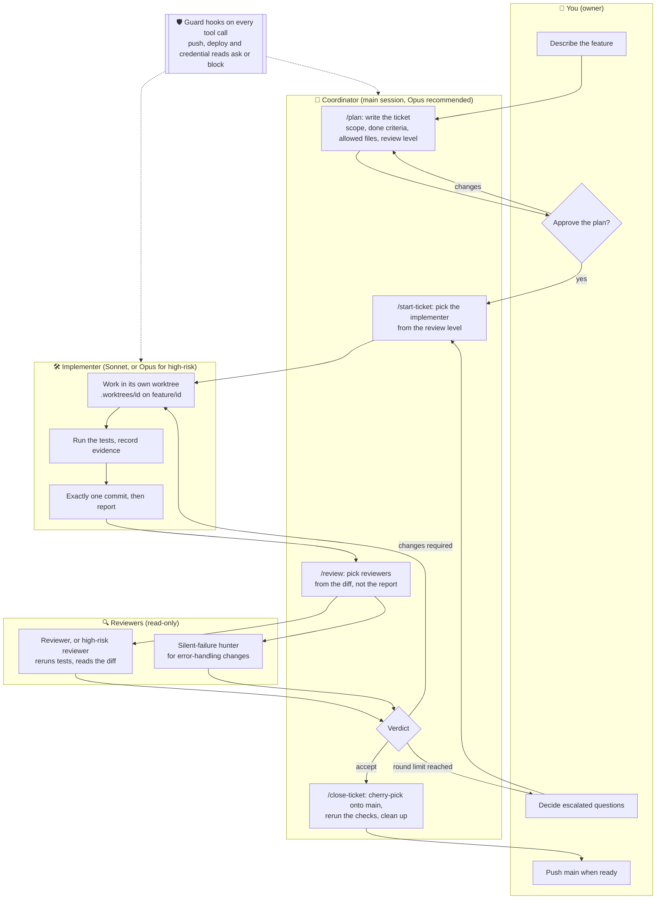

# README draft (Milestone C)

Working notes for the 1.0 README rewrite. Delete this file once the README is written.

## Opening

> # dev-harness
>
> **Let Claude Code agents build your project ticket by ticket, while you stay in charge.**
>
> AI coding agents are fast, but they say "done" without proof, review their own work, wander outside the task, and sometimes push code or delete things you never meant to touch. dev-harness is a Claude Code plugin that gives them a workflow and guardrails:
>
> - **One ticket, one agent, one commit.** Every task gets a written scope, done criteria and a list of files it may touch. An implementer agent does it in its own git worktree, so parallel work never collides.
> - **Independent review that checks evidence, not claims.** A separate reviewer reruns the tests and reads the diff. Risky changes (auth, payments, deletion, security, releases) automatically get a stronger model and a stricter reviewer.
> - **The right model for each role, automatically.** Routine implementation and review run on Sonnet; high-risk tickets and their reviews switch to Opus, with Fable as an opt-in. You don't pick models per task, and you don't pay top-tier prices for routine work.
> - **Nothing leaves your machine without your approval.** Pushes, PRs and deploys always ask first. Credential files can't be read. Agents can't quietly skip a failing test or loosen a lint rule.
> - **A Jira-like board for your Markdown tickets.** Your tickets stay as plain files in the repo. The board is one self-contained HTML page, light and dark, that works offline.
>
> *[board screenshot]*
>
> Built for solo developers and small teams running multi-week projects with Claude Code. It grew out of porting a production Android app to iOS, ticket by ticket.

The pitch leads with the problem. The board comes fourth in the list but carries the only screenshot, placed high on the page.

## Sections, in order

1. **Quickstart (5 minutes):** install, `/ticket-init`, first ticket, `/start-ticket`.
2. **A ticket's life:** one worked example from plan to integration, including a review that sends work back.
3. **The board:** screenshots (board, issue view, light and dark), a link to `docs/examples/board.html`, and the regenerate command.
4. **Guardrails:** what asks, what blocks, and the honest limits (guardrails, not a sandbox; permission deny rules are the hard boundary).
5. **Configuration:** the `harness.json` reference (mostly written in CH-01 to CH-03).
6. **Agents and models:** the table below, and why.
7. **Limits, contributing, license.**

## Flow chart (opens "A ticket's life")

How each role takes a new feature from idea to `main`. GitHub renders Mermaid blocks natively.

Notes:
- The review loop sends findings back to the **same** implementer, which amends its one commit.
- After the round limit (3 by default), the coordinator stops and asks the owner instead of looping.
- Nothing is pushed by an agent; the last step is always the owner's.

## Agents and models table

| Role | Model / effort | When it's used |
|---|---|---|
| Coordinator (main session) | Your choice; Opus recommended | Planning, routing, review decisions, docs upkeep |
| Implementer | Sonnet / medium | Ordinary tickets |
| Implementer (advanced) | Opus / high | Tickets marked high-risk |
| Reviewer | Sonnet / high | Ordinary tickets |
| Silent-failure hunter | Sonnet / high | Error-handling, offline, sync and recovery changes |
| High-risk reviewer | Opus / high, or Fable if you opt in | Auth, payments, deletion, security, shared contracts, releases |

Notes for this section:

- **Model names are aliases.** They are never pinned versions, so new releases are picked up automatically.
- **How routing works.** `/start-ticket` picks the implementer from the ticket's Review level. `/review` picks reviewers from the diff, not from the implementer's report. A diff that turns out riskier than planned upgrades the ticket.
- **The plugin cannot set the main session's model.** Recommend Opus: the coordinator does the judgment work, and its mistakes pass through every later step. It writes little code itself, so the cost stays moderate.

## Who writes docs

| Kind | Who | Model |
|---|---|---|
| Small edits: tracker rows, ticket status, STATUS notes | Coordinator, directly | The main session |
| A docs-only ticket (guide, CHANGELOG, how-to) | Implementer, self-review allowed | Sonnet / medium |
| The public README and quickstart | Coordinator writes it, a reviewer checks it | Opus, then Sonnet / high |
